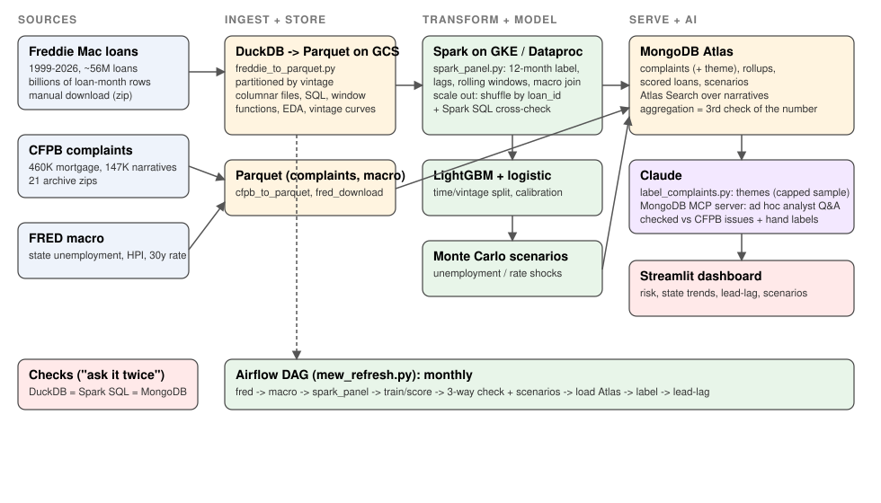

# Mortgage Credit Early-Warning

Predict and stress-test 12-month serious delinquency (90+ days late) on the full Freddie Mac
loan-level history (2.9 billion loan-month rows), joined to FRED macro data and CFPB mortgage complaints.

## 1. The problem

**Who:** mortgage servicers, banks and investors in mortgage bonds. **Decision:** how much to
reserve for losses (CECL), which borrowers to contact first, and what a rise in unemployment or
rates would do to the book. Today they learn late, because reports flag a loan only after it is
30/60/90 days behind. Analysts also tend to use a sample or one year, which hides the 2008 and
2020 regimes and regional differences.

**Questions**
1. Which loans will be 90+ days late within 12 months, using only what was known at the time?
2. Do jumps in a state's CFPB mortgage complaints show up *before* its delinquency rises?
3. How much would portfolio delinquency and expected loss move if unemployment or rates rose?

**A good answer** is a calibrated risk ranking, a tested early-warning signal, and loss ranges
per scenario. A risk team can reserve the right amount and target outreach where it prevents defaults.

## 2. Architecture



| Stage | Tool | Job | Why this tool |
|---|---|---|---|
| Ingest + store | DuckDB -> Parquet on GCS | Convert headerless pipe files to typed, partitioned columnar files; EDA and window-function SQL | Columnar, compressed, fast single-machine SQL; Parquet is the shared format for every engine |
| Transform | Spark on Dataproc (GKE variant in `infra/`) | Build the loan-month panel (12-month look-ahead label, lags, rolling windows, macro join) | 2.9 B rows; every row of a loan must meet on one executor, so we shuffle by `loan_id` and scale out with executors |
| Model | LightGBM + logistic baseline | Risk score with calibration and subgroup checks | Gradient boosting handles mixed and missing features; logistic is the honest baseline |
| Documents + search | MongoDB Atlas (M0) + Atlas Search | Complaints (free text, new fields as Claude labels them), rollups, scored loans, scenarios | Variable-shape documents and full-text search over narratives |
| AI | Claude (API batch labeling + MongoDB MCP server) | Theme labels on a capped sample; ad hoc analyst questions | Checked against CFPB issue categories and an independent human rater |
| Orchestrate | Airflow (`dags/mew_refresh.py`) | Monthly refresh | Dependencies and reruns |
| Serve | Streamlit (`app/dashboard.py`) | Results plus live Atlas Search for the demo | |

### Data layers (bronze / silver / gold)

| Layer | Contents | Location | Built by |
|---|---|---|---|
| Bronze (raw, never edited) | Freddie yearly zips, CFPB archive zips, raw FRED pulls | `gs://<bucket>/raw/` (40.65 GiB) | manual download, `fred_download.py` |
| Silver (cleaned, typed) | Freddie origination + performance Parquet (types cast, coded unknowns such as 9999 set to NULL, `dq_months` parsed, partitioned by quarter); de-duplicated CFPB mortgage complaints; lagged state-month macro table | `gs://<bucket>/silver/` (25.44 GiB) | `freddie_to_parquet.py`, `cfpb_to_parquet.py`, `build_macro.py` (DuckDB) |
| Gold (built for a question) | Loan-month panel with the 12-month label and features; state-month delinquency rollups; scored loans; scenario results; complaint themes; Atlas collections; dashboard inputs | `gs://<bucket>/gold/` (panel 40.84 GiB), MongoDB Atlas | `spark_panel.py` (Spark), `train.py`, `score.py`, `monte_carlo.py`, `label_complaints.py` |

Bronze is immutable so any later layer can be rebuilt from it. Quality work (layout changes, coded
values) happens at bronze to silver; modeling and serving happen at silver to gold.

## 3. Data (not in the repo)

| Source | How to get it | Size |
|---|---|---|
| Freddie Mac Single-Family Loan-Level Dataset, 1999Q1-2026Q2 | Free registration at Freddie Mac Clarity; download the yearly zips by hand into `data/raw/freddie/` | 49,483,298 loans, 2,921,816,568 loan-month rows, 110 quarterly files, 40.65 GiB zipped |
| CFPB Consumer Complaint Database | CFPB complaint archive page; zips into `data/raw/cfpb/` | 464,583 mortgage complaints, 147,249 with a narrative |
| FRED | Free API key; `export FRED_API_KEY=...` | 103 series, 44,468 values (state unemployment, house price index, 30-year rate) |

Freddie Mac does not publish loan counts per quarter. Coverage (Jan 1999 to Jun 2026) matches what it states; its headline
"about 56 million mortgages" includes the Non-Standard dataset, which we did not use, so it is not a like-for-like check
(details in `docs/data_reconciliation.md`).

Hard parts and how they are handled: headerless files and per-year layout changes (layout detected
per file and logged), coded unknowns like 9999 (set to NULL, never imputed), rare events and open
loans (fixed 12-month label, last 12 months unlabeled, time split with a 12-month embargo),
location join only at state-month level, CFPB narratives exist only from March 2015.

**Big-data rule:** the full Freddie history is far larger than a laptop's memory and disk. Spark on
a cluster builds the panel; DuckDB/Parquet does the exploration; each stage uses the engine that fits.

## 4. Setup

```bash
python -m venv .venv && source .venv/bin/activate
pip install -r requirements.txt            # Java 11/17 needed for local pyspark
cp .env.example .env                       # fill in locally; .env is gitignored
set -a; source .env; set +a                # exports FRED_API_KEY, MONGODB_URI, ANTHROPIC_API_KEY
pytest -q                                  # synthetic-data tests, no real data or keys needed
```

## 5. Run the pipeline

```bash
# 1. Ingest (run on a VM with a big disk; resumable, skips finished quarters)
python -m src.ingest.freddie_to_parquet --zips data/raw/freddie/*.zip --out data/parquet --tmp-dir /mnt/tmp
python -m src.ingest.cfpb_to_parquet --inputs data/raw/cfpb/*.zip --out data/parquet/cfpb
python -m src.ingest.fred_download --out data/parquet/fred
python -m src.features.build_macro --fred data/parquet/fred/fred_series.parquet \
       --out data/parquet/macro/state_month.parquet
gsutil -m rsync -r data/parquet $BUCKET/silver
python -m src.queries.silver_report --silver data/parquet --out data/outputs/silver_report   # integrity checks

# 2. EDA (DuckDB over Parquet)
python -m src.eda.profile --parquet data/parquet --cfpb data/parquet/cfpb/mortgage_complaints.parquet \
       --out data/outputs/eda

# 3. Panel on the cluster (Spark), in four year-chunks; finished chunks are marked and skipped on rerun
gcloud dataproc clusters create mew-full --region us-central1 --zone us-central1-a \
       --image-version 2.2-debian12 --master-machine-type e2-standard-4 --num-workers 2 \
       --worker-machine-type e2-standard-4 --worker-boot-disk-size 300GB --max-idle 45m --max-age 12h
export BUCKET=gs://<bucket> REGION=us-central1 CLUSTER=mew-full
bash scripts/run_full_panel.sh               # c1..c4; output gs://<bucket>/gold/panel/source=<quarter>/
gsutil -m rsync -r $BUCKET/gold/panel data/panel_spark
#    single-machine reference on a slice: python -m src.features.build_panel --sources 2019 ...
python -m src.queries.compare_panels --duck data/panel_duck --spark data/spark_slice   # same slice, both engines

# 4. Model, scoring, scenarios (sample 0.2% of loans so the table fits in 16 GB; sample is cached)
export MEW_SAMPLE_CACHE=data/sample_002.parquet
python -m src.models.train --panel data/panel_spark --out data/models --split time \
       --train-end 2021-06 --test-start 2022-07 --sample-frac 0.002
python -m src.models.train ... --out data/models_nomacro --no-macro        # macro ablation
python -m src.models.train ... --out data/models_nohistory --no-history    # payment-history ablation
python -m src.models.train ... --out data/models_vintage --split vintage --train-vintage-max 2017 --test-vintage-min 2019
python -m src.models.score --panel data/panel_spark --models data/models \
       --out data/outputs/portfolio_snapshot.parquet --max-loans 500000
python -m src.scenarios.monte_carlo --snapshot data/outputs/portfolio_snapshot.parquet \
       --models data/models --out data/outputs --n-sims 200 --lgd 0.35

# 5. Atlas + Claude
python -m src.serve.mongo_load complaints --parquet data/parquet/cfpb/mortgage_complaints.parquet --only-narratives
python -m src.serve.mongo_load indexes                       # Atlas Search index
python -m src.ai.label_complaints --parquet data/parquet/cfpb/mortgage_complaints.parquet \
       --out data/labels --n 3000 --write-mongo
python -m src.ai.validate_labels cfpb --parquet data/parquet/cfpb/mortgage_complaints.parquet \
       --labels data/labels/claude_labels.csv --out data/outputs
python -m src.ai.hand_label_cli --template data/labels/hand_label_template.csv --out data/labels/hand_labels.csv
python -m src.ai.validate_labels hand --labels data/labels/claude_labels.csv \
       --hand data/labels/hand_labels.csv --out data/outputs
python -m src.serve.mongo_load scores --parquet data/outputs/portfolio_snapshot.parquet --top 50000
python -m src.serve.mongo_load scenarios --csv data/outputs/scenario_summary.csv

# 6. Ask it twice: the same number in DuckDB, Spark SQL and MongoDB
python -m src.queries.state_quarter --parquet data/parquet --out data/outputs --mongo          # full history
python -m src.queries.state_quarter --parquet data/parquet --out data/outputs_slice --spark \
       --sources 2008Q1 2008Q2 2008Q3 2008Q4 2019Q1 2019Q2 2019Q3 2019Q4                     # Spark SQL slice
python -m src.queries.loan_counts --parquet data/parquet      # join integrity; see docs/data_reconciliation.md

# 7. Question 2, benchmark and the dashboard
python -m src.analysis.complaints_lead_lag --rollup data/outputs/state_month_rollup.parquet \
       --complaints data/parquet/cfpb/mortgage_complaints.parquet --out data/outputs
python -m src.bench.benchmark --panel data/panel_spark --out data/outputs/benchmark
streamlit run app/dashboard.py -- --outputs data/outputs --models data/models
```

For the interactive MCP demo see `mcp/claude_desktop_config.template.json` and `docs/demo_script.md`.
All verified numbers below are also logged in `results/RESULTS.md`, with the model and scenario outputs in `results/`.

## 6. How results are checked

- **Same number, several ways:** state-by-quarter 90+ day rate in DuckDB SQL (raw Parquet), Spark SQL
  (raw Parquet) and a MongoDB aggregation over the stored state-month rollup. `state_quarter.py`
  exits non-zero unless counts match exactly.
- **Spark vs DuckDB panel:** `compare_panels.py` on 8 quarters (2008, 2019; 128.6 M rows) found identical
  row counts, labels, positives and delinquency sums. `tests/test_spark_equivalence.py` asserts the same on synthetic data.
- **No leakage:** features use rows at or before month t; macro series are lagged by their release
  delay (`build_macro.py`); time split enforces a >12-month embargo; train/validation split is by loan.
- **Calibration and groups:** `train.py` reports AUC, average precision, Brier, ECE, isotonic
  recalibration, and metrics by credit band, LTV, DTI, occupancy, channel, vintage and year.
- **AI output:** Claude's themes are scored against CFPB's own issue categories (rule mapping) and
  against labels from an independent human rater (accuracy and Cohen's kappa).
- **Q2 lead-lag:** state and month fixed effects, clustered errors, controls for delinquency
  momentum, and a placebo that shuffles complaints across states.
- **Q3 scenarios:** the model re-scores the current book under shocked macro inputs. This shows what
  the model predicts, not a causal effect. LGD is an assumption set by `--lgd`.

## 7. Results

### Scale

| | |
|---|---|
| Freddie loans / loan-month rows | 49.48 M / 2.92 B (110 quarters, 1999-2026) |
| Gold panel (at-risk loan-months) | 2.85 B rows, 2.70 B with a 12-month label, 1.21% positive, 40.84 GiB Parquet |
| Spark build (Dataproc, 2 workers x e2-standard-4 = 8 worker vCPUs) | 5 h 13 min in 4 chunks, about 9.3 M input rows/min |
| Single machine for comparison | DuckDB (4 vCPU) rebuilt 8 quarters (about 150 M rows) in about 3 min |

| Chunk | Sources | Input rows | Duration |
|---|---|---|---|
| c1 | 1999-2009 | 1.28 B | 1 h 58 min |
| c2 | 2010-2014 | 655 M | 1 h 11 min |
| c3 | 2015-2019 | 422 M | 55 min |
| c4 | 2020-2026 | 563 M | 1 h 10 min |

### Same number, computed more than one way

| Check | Scope | Result |
|---|---|---|
| Panel: DuckDB vs Spark | 8 quarters, 128.6 M rows | identical counts, labels, positives, delinquency sums |
| State-quarter rate: DuckDB vs MongoDB | full history, 5,939 rows | 0 mismatches, max rate difference 0.0 |
| State-quarter rate: DuckDB vs Spark SQL | 2008 and 2019 vintages, 3,996 rows | 0 mismatches, max rate difference 0.0 |

### Q1: predicting 12-month serious delinquency

Time split: train to 2021-06, test from 2022-07 (12-month embargo), 0.2% loan sample. Test base rate 0.71%.

| Model | AUC | Avg precision | Brier | ECE |
|---|---|---|---|---|
| Logistic | 0.866 | 0.238 | 0.00612 | 0.0012 |
| **LightGBM** | **0.893** | **0.277** | **0.00585** | **0.0011** |
| LightGBM + isotonic | 0.891 | 0.264 | 0.00587 | 0.0015 |

| LightGBM variant | AUC | Avg precision | ECE | Mean predicted (actual 0.71%) |
|---|---|---|---|---|
| All features | 0.893 | 0.277 | 0.0011 | 0.63% |
| No macro features | 0.892 | 0.264 | 0.0063 | 1.35% |
| No payment-history features | 0.796 | 0.043 | 0.0024 | 0.48% |
| Vintage split (loans never seen in training) | 0.869 | 0.252 | 0.0014 | 0.63% (base 0.76%) |

- Average precision 0.277 is about 39 times the base rate.
- Payment history carries most of the signal; static loan features plus macro still reach AUC 0.80.
- Macro inputs barely change the ranking but fix the predicted level: without them the model predicts about twice the actual rate.
- Isotonic recalibration did not help (its validation split shares loans and period with training).
- Caveats: one run, no confidence intervals, 0.2% loan sample; the time split reuses loans across train and test, so the vintage split is the stricter number.

### Q2: do complaint surges lead delinquency?

State-month panel, state and month fixed effects, errors clustered by state, 20 placebo shuffles. Effect of a 1-SD surge on the
change in a state's 90+ rate (percentage points) h months later.

| Series | h | Coef | p | Beats placebo |
|---|---|---|---|---|
| all mortgage | 1 / 3 / 6 / 9 / 12 | -0.0044 / -0.0093 / -0.0077 / -0.0061 / -0.0055 | 0.010 / 0.127 / 0.122 / 0.283 / 0.372 | none |
| hardship ("struggling to pay") | 1 / 6 / 9 / 12 | -0.0014 / -0.0078 / -0.0099 / +0.0013 | 0.170 / 0.038 / 0.012 / 0.864 | 6 and 9 (negative sign) |

**Finding: no evidence that complaint surges precede rises in delinquency.** The only results that beat the placebo are negative
(a hardship surge is followed by a slightly lower rate). Nine tests were run, so treat these as weak. Complaints cover all lenders
while delinquency is Freddie Mac only. Association, not causation. (The h=3 hardship fit did not converge and is omitted.)

### Q3: stress scenarios (June 2026 book)

500,000 current loans scored (mean 12-month PD 0.77%, UPB-weighted 0.81%). Monte Carlo, 200 shock draws per scenario on a
100,000-loan sample (about $24 B UPB). Loss = PD x UPB x LGD with **LGD = 0.35 assumed**.

| Scenario | Delinquency rate p05 / p50 / p95 | Change vs baseline | Expected loss p50 |
|---|---|---|---|
| baseline | 0.756% / 0.776% / 0.794% | - | $65.3 M |
| unemployment +2 pp | 0.811% / 0.831% / 0.843% | +7% | $69.8 M |
| mortgage rates +200 bp | 0.757% / 0.773% / 0.790% | about 0 | $63.8 M |
| stagflation (+2 pp, +200 bp) | 0.806% / 0.831% / 0.840% | +7% | $68.3 M |
| severe recession (+4 pp, -100 bp) | 0.881% / 0.949% / 1.005% | +22% | $82.1 M |

Only macro inputs are shocked; payment-history features are held fixed, so second-round effects (more loans slipping late) are not
captured. Treat this as a lower bound on macro sensitivity, not a forecast. Bands show shock draws only, not model uncertainty.

### AI step: Claude complaint themes

Claude Haiku 5.5 labeled 3,000 complaints into six themes (payment hardship, servicing error, escrow, modification denial,
foreclosure, origination/other), stored on the Atlas documents so Atlas Search can filter and facet on them.

| Check | n | Agreement | Kappa |
|---|---|---|---|
| vs independent human rater | 70 | 65.7% (70.0% with overlapping themes merged) | 0.56 |
| vs CFPB issue-category mapping (weak sanity check) | 3,000 | 46% | 0.31 |

The independent rater labeled 70 randomly drawn complaints blind: they saw only the complaint text, never Claude's labels,
and did not know the labels were being compared with a model's.
An earlier 200-row pass labeled by the project author agreed 41.5%; the same rater agreed with their own later labels only 41%,
and the pass contained clear mistakes, so the independent rater is the reference. The themes overlap (escrow vs servicing error,
hardship vs modification), which caps human agreement too. Treat the labels as a coarse aid for search, not a measurement.

### Query latency (VM in GCP us-central1; Atlas M0 free tier on AWS us-east-1)

| Engine | Query | p50 | p95 |
|---|---|---|---|
| DuckDB over Parquet | aggregate by state, 69.1 M panel rows (2019 vintages) | 1.05 s | 1.08 s |
| DuckDB over Parquet | one loan's history (partition pruned) | 91 ms | 93 ms |
| MongoDB | scored loan by `_id` | 29 ms | 30 ms |
| MongoDB | top 20 riskiest loans in a state | 30 ms | 30 ms |
| MongoDB | quarterly rates for a state (rollup) | 61 ms | 66 ms |
| Atlas Search | full-text over 147 K narratives | 39 ms | 50 ms |
| Atlas Search | same, filtered to a state | 39 ms | 43 ms |

Analytic scans suit Parquet and DuckDB; key lookups and text search suit Mongo and Atlas Search. Mongo timings include a cross-cloud
network hop (about 29 ms floor); the DuckDB scan is warm-cache; M0 is a shared tier. Indicative numbers only.

## 8. Queries, agent controls and refresh
- Key queries with results: [`docs/queries.md`](docs/queries.md)
- How Claude was used and controlled: [`docs/AGENTS.md`](docs/AGENTS.md)
- Refreshing piece: `python -m src.ingest.cfpb_live --dry-run` (CFPB API, updated daily; metadata only, no narratives, stored in `complaints_live`); daily DAG `mew_cfpb_daily_live` (written, not executed)

## 8a. Dashboard (hosted)
`streamlit run app/dashboard.py` runs the dashboard. It uses `data/` when present and otherwise the small
snapshot of result files in `app/demo_data/`, so it also runs on Streamlit Community Cloud
(main file `app/dashboard.py`, dependencies in `app/requirements.txt`). The "Live Atlas" tab needs a
`MONGODB_URI` secret for a read-only database user; it is set in the hosting settings, never in the repo.
Live URL: _add after deploying_

## 8b. Limits

Complaints cover all lenders while loans are Freddie Mac only, so they join at state-month level. Narratives are about a third of
complaints and exist only from March 2015. Scenario results inherit the model's learned macro sensitivity and hold payment history
fixed. The models were trained on a 0.2% loan sample because the sampled table must fit in 16 GB of memory. The 2020 forbearance
period changes what delinquency means; report by period (see `groups_lgbm.csv`). Atlas M0 has a 512 MB limit, so only complaints with
narratives are stored and scored loans are capped at 50,000.

## 9. Security

No keys or connection strings in this repo. `FRED_API_KEY`, `MONGODB_URI`, `ANTHROPIC_API_KEY` are read
from the environment only; the MCP server uses a separate read-only database user. Run `bash scripts/secret_scan.sh`
before pushing, zipping, or recording.
